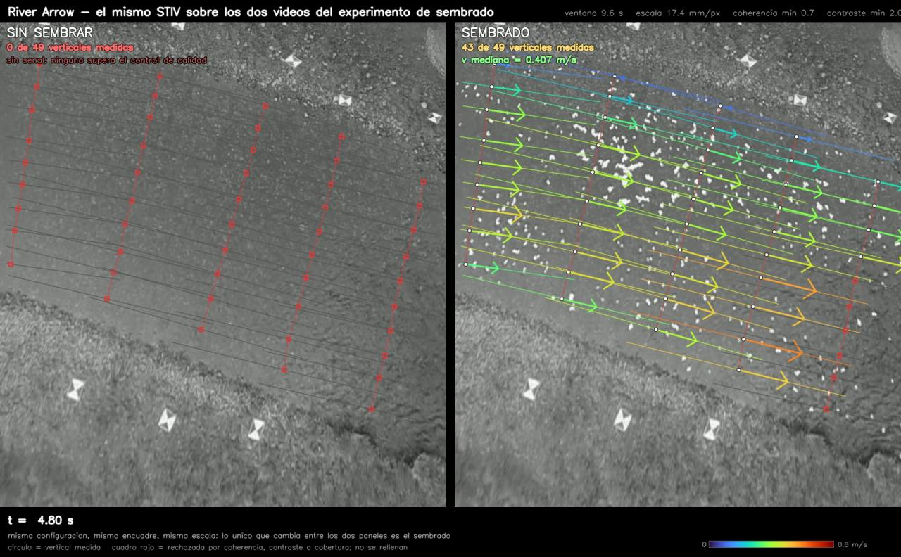

# Capturas de los datasets y de los resultados

> **Reorganizacion:** esta carpeta se llamaba `capturas_datasets/ (en la raiz)`. El texto de abajo conserva los nombres y rutas de la estructura anterior; la tabla de equivalencias esta en el `README.md` de la raiz. Las rutas del codigo ya estan actualizadas.

Los videos de prueba (`datasets vision velocimetria/`, 202 videos, 17 GB de video dentro de 45 GB de
datos) y los videos de resultados no van al repositorio. Esta carpeta guarda en su lugar **una imagen
de cada uno**, en JPEG reducido: **17 MB en total**.

| Carpeta / archivo | Que hay |
|---|---|
| `hojas_contacto/` | Un mosaico por dataset con la miniatura y el nombre de cada video. Lo mas rapido para ver que hay |
| `videos/` | Un fotograma de cada video (el de la mitad de su duracion), 640 px de lado mayor. Misma estructura de carpetas que el dataset |
| `indice_videos.csv` | Por video: ruta, resolucion, fps, fotogramas, duracion, tamano y que fotograma se capturo |
| `resultados/` | Fotogramas de los videos de resultado y las figuras de cada caso, 1280 px |
| `resultados/validacion_directo/` | Una medida del programa en directo sobre cada video con referencia, mas su salida de texto |
| `generar_capturas.py` | El script que lo rehace todo |

Dos avisos para leer las imagenes:

- **18 capturas tienen el contraste estirado** (columna `contraste_estirado` del indice): las que tienen
  la mediana de brillo por debajo de 20/255, donde la captura tal cual seria un rectangulo negro. Son
  el Bradano (agua a 0.12/255), las GoPro del Brenta, el Noce, el Basento y tres videos de Boneyard grabados de madrugada o al
  anochecer. No es el aspecto real del video.
- Las camaras Reolink de Heiskanen estan montadas de lado. En `videos/` salen giradas como dicen sus
  metadatos (verticales); en `resultados/validacion_directo/` salen en la orientacion nativa, que es
  en la que esta su modelo de camara y en la que mide el programa.

## Los videos del dataset

| Dataset | Videos | Tamano | Duracion | Hoja de contacto |
|---|---|---|---|---|
| USGS Boneyard Creek (camara IP fija, 2017-2018) | 61 | 2.5 GB | 37 min | [Boneyard_Creek.jpg](hojas_contacto/Boneyard_Creek.jpg) |
| Heiskanen et al., Oulankajoki (RGB + termica, 2023-2024) | 48 | 1.8 GB | 24 min | [Heiskanen_Oulankajoki_River.jpg](hojas_contacto/Heiskanen_Oulankajoki_River.jpg) |
| Heiskanen et al., Vantaanjoki Pitkakoski (RGB + termica) | 46 | 2.1 GB | 23 min | [Heiskanen_Vantaanjoki_Pitkakoski.jpg](hojas_contacto/Heiskanen_Vantaanjoki_Pitkakoski.jpg) |
| HARMONIOUS (13 rios; Murg solo publica fotogramas) | 42 | 9.2 GB | 17 min | [HARMONIOUS.jpg](hojas_contacto/HARMONIOUS.jpg) |
| Otros: Hommerich (2), Field Videos (2), Basento (1) | 5 | 1.9 GB | 3 min | [Otros.jpg](hojas_contacto/Otros.jpg) |


## Resultados de las pruebas

Los casos completos (notebooks, figuras originales en PNG, videos) estan en `test_pyorc/analisis_*` y
en `analisis_kurome_directo_stiv/validacion/`. Aqui va una imagen de cada uno. De cada video de
resultado hay dos fotogramas, al 25 % y al 75 %, para que se vea que la medida cambia con el tiempo.

### Programa en directo contra referencias (`resultados/validacion_directo/`)

`stiv_directo.py` pasado por videos con medida independiente, con el mismo codigo que corre en
directo. Cada imagen es **la medida del medio del video** (ni la mejor ni la peor), dibujada por el
propio programa: video con flechas, vista rectificada y el STI de cada estacion con su pendiente. Las
cifras de la tabla son las del video entero (mediana de todas sus medidas), y estan en el `.txt` de
cada caso.

| Caso | Referencia | Resultado |
|---|---|---|
| [USGS Sile Main Canal](resultados/validacion_directo/sile.jpg) (dron, sin estabilizar) | aforo ADV | 11/11 verticales, **Q 1.4537 vs 1.4362 m3/s (+1.2 %)** |
| [Rio Bradano](resultados/validacion_directo/bradano.jpg) (HARMONIOUS) | 7 verticales | 5/7, sesgo -4.5 %, RMSE 0.070 m/s, r +0.992 |
| [Oulankajoki 08:03](resultados/validacion_directo/heiskanen_08-03-04.jpg) y [09:03](resultados/validacion_directo/heiskanen_09-03-04.jpg) | ADCP | 7-8 de 20 estaciones (el tercio cercano), **-14 a -18 %**, sin explicar |
| Oulankajoki [10:03](resultados/validacion_directo/heiskanen_10-03-04.jpg), [11:03](resultados/validacion_directo/heiskanen_11-03-04.jpg), [12:01](resultados/validacion_directo/heiskanen_12-01-04.jpg) | ADCP | 1-3 de 20: sol de cara, agua saturada, el programa se abstiene |
| [Oulankajoki 13:03](resultados/validacion_directo/heiskanen_13-03-04.jpg) | ADCP | 15 de 20 a **+35 %**: destellos del sol aceptados con coherencia alta. El caso peligroso |


### Casos con notebook

| Caso | Que es | Resultado | Imagenes |
|---|---|---|---|
| **Boneyard Creek** | STIV con camara oblicua sin geometria | 0.2427 alturas de camara/s, 16 de 21 estaciones; sin caudal (no hay seccion) | [`resultados/boneyard/`](resultados/boneyard/): 6 videos (tiempo real, manual, con y sin nivel) + fig1-fig8 |
| **Rio Bradano** | STIV sobre video ya ortorrectificado | 5 de 7 verticales, sesgo -3.1 %, RMSE 0.068 m/s | [`resultados/bradano/`](resultados/bradano/): video + fig1-fig8 |
| **River Arrow** | Experimento sembrado / sin sembrar | sin sembrar: 0 de 49 estaciones (el resultado buscado); sembrado: 0.389 m/s, -6.7 % en la media | [`resultados/arrow/`](resultados/arrow/): video + fig1-fig9 |
| **Geul en Hommerich** | STIV metrico con camara oblicua calibrada | v superficial 0.943 m/s, Q 13.68 m3/s (sin referencia que lo valide) | [`resultados/hommerich/`](resultados/hommerich/): video |





## Como se rehace

Desde esta carpeta, con el `.venv` del programa en directo (solo numpy y OpenCV):

```powershell
..\analisis_kurome_directo_stiv\.venv\Scripts\python.exe generar_capturas.py videos       # ~10 min, lee los 202 videos
..\analisis_kurome_directo_stiv\.venv\Scripts\python.exe generar_capturas.py resultados   # ~1 min
..\analisis_kurome_directo_stiv\.venv\Scripts\python.exe generar_capturas.py validacion   # ~5 min
```

`validacion` vuelve a correr `validacion/caso_sile.py`, `caso_bradano.py` y `caso_heiskanen.py` sin
tocarlos: solo intercepta cada medida para quedarse con su fotograma. Al generarla el 2026-10-14 sus
salidas de texto coincidieron linea a linea con las guardadas en `validacion/salidas/` (salvo el tiempo
de ejecucion). Necesita el dataset en `datasets vision velocimetria/` y el video del Sile en
`test_pyorc/USGS/Video/`. Los avisos `[h264] error while decoding MB` al leer Boneyard son fotogramas
corruptos del propio dataset y no afectan.
